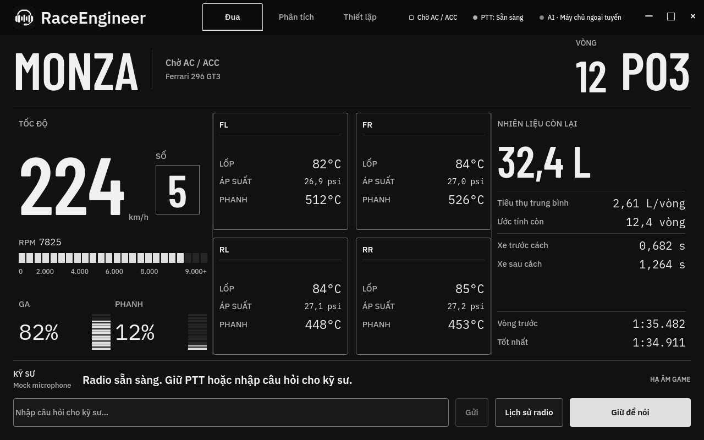

[![Contributors][contributors-shield]][contributors-url] [![Forks][forks-shield]][forks-url] [![Stars][stars-shield]][stars-url] [![Issues][issues-shield]][issues-url] [![MIT License][license-shield]][license-url]

  

  <h1 align="center">RaceEngineer</h1>

  

    A race engineer for sim racing
     
    <a href="https://github.com/tminh-U/RaceEngineer/issues">Report a bug</a>
    ·
    <a href="https://github.com/tminh-U/RaceEngineer/issues">Request a feature</a>
  

<!-- TODO: Replace the text, links, screenshots, and roadmap items below with your final project details. -->

  
Table of Contents

  <ol>
    <li><a href="#project-information">Project Information</a></li>
    <li><a href="#getting-started">Getting Started</a></li>
    <li><a href="#documentation">Documentation</a></li>
    <li><a href="#contributing">Contributing</a></li>
    <li><a href="#contact">Contact</a></li>
  </ol>

## NOTE : The software only support running AI on CPU and AMD GPU (No Nvidia GPU support in the future)

## Project Information

RaceEngineer is a local race-engineering application that processes telemetry data from the game, calculates race logic, and handles voice input and output.

#### Features

- Read and analyze telemetry from Assetto Corsa and Assetto Corsa Competizione.
- Predict fuel usage, lap times, the distance between cars, and more.
- Communicate with the driver in real time in Vietnamese using `Phowhisper` and `VieNeu-TTS`.
- Important spotter messages remain available even without an LLM or network connection.
- Intuitive settings with features that can be enabled or disabled during use.
- Multiple voices to choose from, with files for training a custom voice for each user.
- Compatible with OpenAI-style LLMs.

  

## Built with

- C++20
- CMake
- Qt 6 / Qt Quick
- MSVC Windows x64
- whisper.cpp and PhoWhisper-small Q5_1
- Native VieNeu-TTS v3 Turbo
- Vulkan acceleration

## Supported games

- Assetto Corsa
- Assetto Corsa Competizione

## Getting Started

### Requirements

- Windows x64 and an AVX2-capable CPU.
- A working Vulkan driver/runtime, including when CPU compute is selected.
- Assetto Corsa and/or Assetto Corsa Competizione.
- A microphone for voice input; an API provider/key and network connection for LLM conversation.

The installer bundles local runtime models and voices. Visual Studio, CMake and the Qt SDK are only required for [source builds](docs/build.md).

### Quickstart

1. Close AC, ACC and RaceEngineer. Download and run the installer from [Releases](https://github.com/tminh-U/RaceEngineer/releases/latest).
2. The installer detects Steam libraries, installs/enables the bundled AC Python companion, and configures ACC Broadcasting for detected games. Existing valid ACC ports/passwords and unrelated settings are preserved; changed files are backed up alongside the originals.
3. Launch RaceEngineer and complete the initial voice/AI setup. Choose your microphone and speaker under **Settings → System & Devices**. LLM API settings and TTS settings are separate.
4. Open **System & Devices → Game connections** and refresh the installation status. If AC was not found, choose its folder containing `acs.exe`, then install/update the companion. For ACC, use **Set up ACC UDP** with the game closed; launch ACC once if its user folder has not yet been created.
5. Restart AC/Content Manager or ACC after setup, then enter a track session. Confirm Cockpit connects and displays live data. A valid configuration alone does not prove the game is transmitting.
6. Hold **Ctrl+Space** to speak, release to send, or map a DirectInput wheel button. Spotter availability still depends on simulator data: AC requires the current companion; ACC Broadcasting does not expose wheel-contact geometry for proximity Spotter.
7. Use **System & Devices → Version & updates → Check for updates** to check GitHub stable releases, including newer builds reissued under the same version. Open the release page, close the app/game, and run the downloaded installer to update.

Portable users must extract the complete package and run `bin/RaceEngineer.exe`, then use the in-app setup controls; installer setup does not run for ZIP extraction. Permission errors, running games and invalid configuration files are reported for repair instead of assuming setup succeeded.

ACC configuration uses Windows Documents at `Assetto Corsa Competizione/Config/broadcasting.json`. The official port key is `updListenerPort`; the legacy `udpListenerPort` alias remains readable. Setup preserves valid ports and creates a default port of 9000 only when needed.

See the [detailed Quickstart and troubleshooting (Vietnamese)](docs/quickstart.md), [logging guide](docs/logging-guide.md), and [source build guide](docs/build.md).

## Documentation

- [Architecture](docs/architect.md): overview and subsystem chapters.
- [Runtime and UI](docs/architecture/runtime-ui-storage.md): lifecycle, threads, settings and release.
- [Telemetry and Spotter](docs/architecture/telemetry-radar-spotter.md): AC/ACC sources and radar geometry.
- [STT and TTS](docs/architecture/voice-stt-tts.md): local voice and radio pipeline.
- [LLM prompts and tools](docs/architecture/llm-prompts-tools.md): conversation and feature controls.
- [XGBoost and strategy](docs/architecture/strategy-xgboost.md): runtime approval gates, recording and research training.
- [Build Guide](docs/build.md): development and release build instructions.
- [Voice Training Guide](docs/training.md): training a custom VieNeu-TTS voice.
- [Logging Guide](docs/logging-guide.md): preparing confirmed Race recordings for local training.
- [Vietnamese README](docs/readme_vie.md)

## Contributing

Contributions are welcome.

1. Fork the project.
2. Create a feature branch: `git checkout -b feature/my-feature`
3. Make and test your changes.
4. Commit your changes: `git commit -m "Add my feature"`
5. Push the branch and open a pull request.

Please keep simulator-specific telemetry inside its provider and preserve deterministic behavior for safety-critical spotter messages.

## Contact

Le Dinh Tue Minh - [@tminh-U](https://github.com/tminh-U)

## Acknowledgments

- [VieNeu-TTS](https://github.com/pnnbao97/VieNeu-TTS)
- [Phowhisper](https://github.com/VinAIResearch/PhoWhisper)
- [whisper.cpp](https://github.com/ggerganov/whisper.cpp)
- [Qt](https://www.qt.io/)
- Assetto Corsa and Assetto Corsa Competizione shared-memory telemetry

<!-- MARKDOWN LINKS & IMAGES -->

[license-shield]: https://img.shields.io/github/license/tminh-U/RaceEngineer.svg?style=for-the-badge
[license-url]: https://github.com/tminh-U/RaceEngineer/blob/main/LICENSE
[windows-shield]: https://img.shields.io/badge/platform-Windows%20x64-0078D4?style=for-the-badge&logo=windows
[windows-url]: https://github.com/tminh-U/RaceEngineer
[contributors-shield]: https://img.shields.io/github/contributors/tminh-U/RaceEngineer.svg?style=for-the-badge
[contributors-url]: https://github.com/tminh-U/RaceEngineer/graphs/contributors
[forks-shield]: https://img.shields.io/github/forks/tminh-U/RaceEngineer.svg?style=for-the-badge
[forks-url]: https://github.com/tminh-U/RaceEngineer/network/members
[stars-shield]: https://img.shields.io/github/stars/tminh-U/RaceEngineer.svg?style=for-the-badge
[stars-url]: https://github.com/tminh-U/RaceEngineer/stargazers
[issues-shield]: https://img.shields.io/github/issues/tminh-U/RaceEngineer.svg?style=for-the-badge
[issues-url]: https://github.com/tminh-U/RaceEngineer/issues
