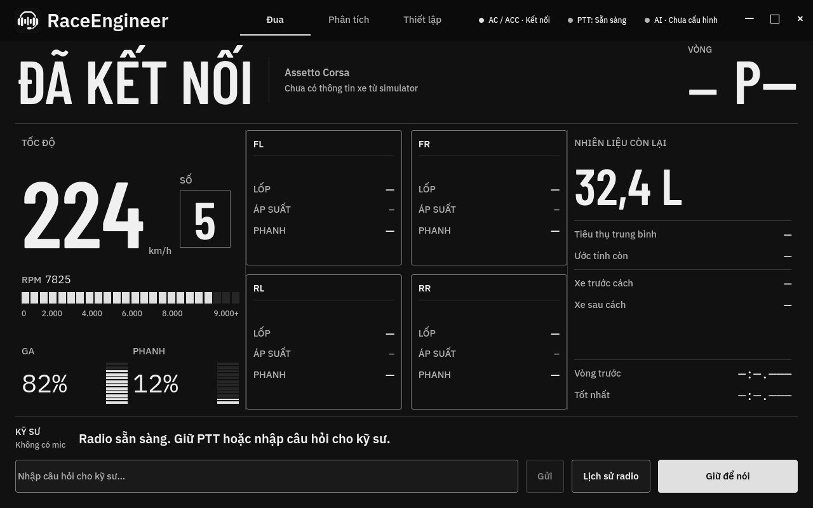
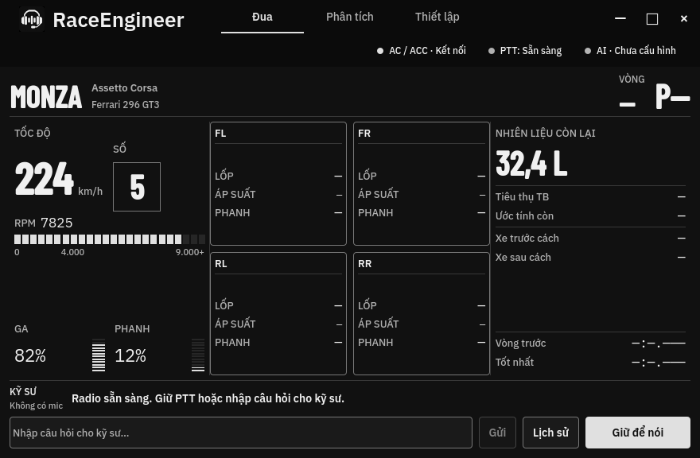

# v1.0.6 metadata reissue — 2026-10-20

- Binary/tag source: `b0ecd9699c310d42dfbd525b7d29fe8ee40b6b4e`. AC/ACC static metadata now refreshes during the connection, missing static/graphics mappings are retried, and the Cockpit distinguishes connected telemetry with missing names from a disconnected simulator.
- [Qt UI regression](metadata-ui-report.json): 12/12 cases at 880×576 and 1280×800, no QML warnings or Qt logs. Covers missing names, track-only/car-only metadata, late/changed names and disconnection with stale names. Root reviewed the captures and matched source hashes.
- [Windows build 39392660681](https://github.com/tminh-U/RaceEngineer/actions/runs/39392660681): 7/7 CTests passed. The new `TelemetryMetadataTests` passed in 13.36 seconds using the actual AC and ACC providers with synthetic Windows mappings. It covers absent/zeroed pages, delayed metadata/graphics, changed track/car, stale subclass/metadata removal and reconnects. Native and packaged setup UI assertions, version/manifest and embedded app/installer icon checks also passed.
- [Reissue workflow 39395396279](https://github.com/tminh-U/RaceEngineer/actions/runs/39395396279) verified the source build, both package hashes, all 1762 manifest files and the tested executable hashes, then replaced the existing v1.0.6 tag, installer, portable ZIP, checksum file and release notes.
- Public asset digests, checksums, tag, portable manifest and executable match the CI evidence. Original voice model hashes and the Minh Quân preset are preserved. See [verification record](release-verification.json) and [SHA256SUMS](SHA256SUMS.txt).

## Qt captures

Synthetic live telemetry with metadata missing:

Metadata arriving later at the minimum supported window size:

The Qt captures use an offscreen facade. Windows metadata tests execute the real readers against synthetic mappings; neither substitutes for a real AC/ACC session. No real game, companion UDP server, interactive UAC or in-app updater network flow was exercised. Setup UI assertions passed, but instances were terminated after their exit grace period during model warmup; orderly shutdown during warmup remains unverified. AVX2 and a working Vulkan runtime/driver remain required.

Download the replacement [v1.0.6 installer](https://github.com/tminh-U/RaceEngineer/releases/download/v1.0.6/RaceEngineer-1.0.6-Setup.exe); previously downloaded v1.0.6 files do not contain this fix.
