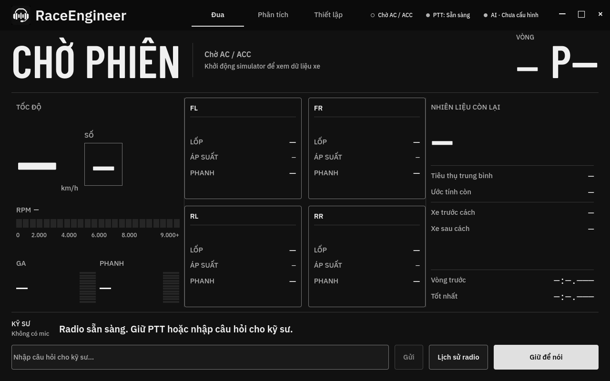
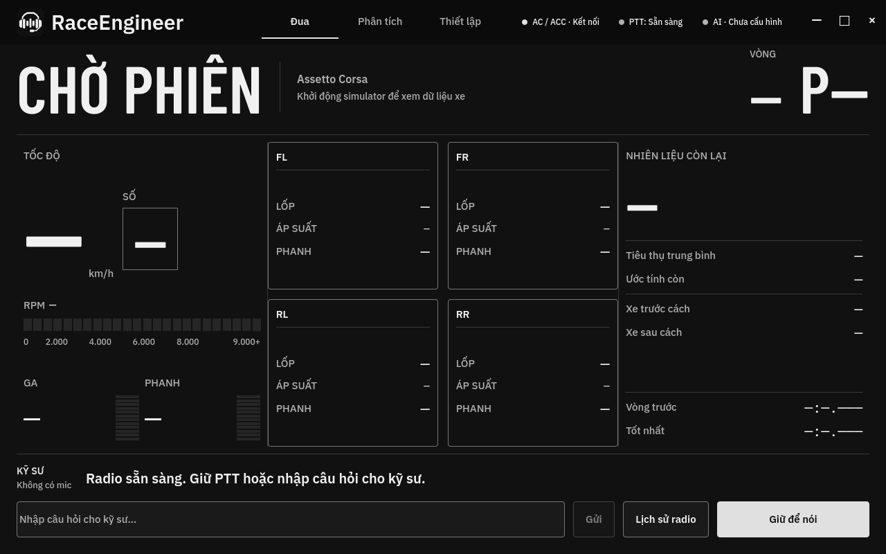

# v1.0.6 reissue — 2026-10-20

- Binary source and current tag: `bc143b0c56ef9507e26b76fec3e70c787cb8bc3c`. The app change is one QML line: disconnected status uses a hollow circle; connected status retains a filled circle.
- [Windows build 39363124808](https://github.com/tminh-U/RaceEngineer/actions/runs/39363124808): 6/6 CTests, native and packaged setup assertions, executable version, package manifest and embedded app/installer icons passed.
- [Reissue workflow 39365222484](https://github.com/tminh-U/RaceEngineer/actions/runs/39365222484): verified the successful source build, hashes of both packages and all 1762 manifest files, and native UI executable hashes before replacing the existing tag and three release assets. It consumes the verified Windows artifacts on GitHub Actions; it does not rebuild them.
- Root matched the public [release](https://github.com/tminh-U/RaceEngineer/releases/tag/v1.0.6) asset digests and [SHA256SUMS](SHA256SUMS.txt), then read the public portable ZIP's manifest and executable. Their commit/hash match the CI evidence. Voice model hashes remain unchanged, including the Minh Quân preset.
- [Verification record](release-verification.json); [four Qt marker cases](status-marker-report.json). Qt 6.8.3 rendered 880×576 and 1280×800 with connected/disconnected states, no QML warnings or Qt logs, and an 8×8 marker with radius 4. Root reviewed the 1280×800 captures.

Qt marker captures use an offscreen fake facade. The Windows native assertions passed, but the harness terminated instances after their exit grace period while models were warming up; orderly shutdown is not verified. Real simulator, audio and input hardware sessions were not exercised for this UI hotfix. AVX2 and a working Vulkan runtime/driver remain required.
